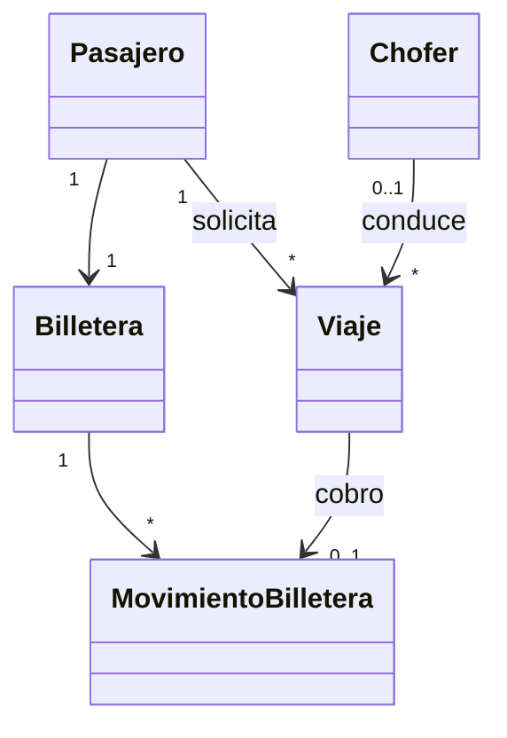

# Modelo de dominio

## Alcance confirmado

- Roles: pasajero, chofer, operador y administrador.
- Viaje con los estados exigidos por el enunciado.
- Billetera del pasajero formada por movimientos de carga y consumo.
- Dinero representado en centavos enteros.
- Un cobro de finalización puede quedar en `pago_pendiente` si el saldo no alcanza.

## Invariantes confirmadas

1. Un viaje se asigna a un solo chofer y un chofer tiene un solo viaje activo.
2. El saldo no se sobrescribe: se calcula desde movimientos confirmados.
3. Un mismo cobro o webhook no puede producir dos movimientos al reintentarse.
4. Dos cobros concurrentes no pueden consumir un saldo que alcanza para uno solo.
5. La tarifa se calcula en servidor y los importes se expresan en centavos enteros.
6. Un índice único parcial impide que un chofer tenga dos viajes activos.
7. Un índice único parcial impide dos consumos de billetera para el mismo viaje.

## Persistencia propuesta

Hay tres bases en el mismo contenedor, cada una con su rol (ADR 008): `viajes` (todo lo que no es billetera, más `outbox_viajes`), `billetera` (billeteras, movimientos, webhooks, `eventos_consumidos`, `outbox_billetera`) y `lectura` (proyecciones, ADR 009). No hay claves foráneas ni consultas entre bases.

- `viajes`, `ofertas_viaje` y `eventos_viaje` representan el ciclo del viaje y permiten reconstruir eventos SSE.
- `billeteras` identifica y bloquea la billetera del pasajero, sin guardar un saldo.
- `movimientos_billetera` es un libro inmutable: los débitos y créditos son importes positivos en centavos y el tipo determina el signo.
- `claves_idempotencia` recuerda el resultado de una intención HTTP por actor y ámbito.
- `eventos_webhook_pago` deduplica por el identificador del proveedor antes de crear una carga.
- PostGIS almacena `origen`, `destino` y ubicaciones como `geography(Point, 4326)` indexada con GiST.

## Billetera

- **Dinero en centavos enteros** (`src/dominio/billetera/dinero.js`). En punto flotante `0.1 + 0.2 !== 0.3`, porque los binarios no representan exactamente las fracciones decimales; con enteros la suma es exacta. `validarCentavos` rechaza todo lo que no sea un `Number.isSafeInteger` ≥ 0. En la base, todas las columnas `*_centavos` son `INTEGER`. Lo muestra `tests/dominio/billetera.test.js`.
- **El saldo no se guarda: se calcula.** Es la suma de las cargas menos los consumos de `movimientos_billetera` (`calcularSaldo` en el dominio, `SUM` en el repositorio). No existe una columna "saldo" que se pueda pisar, así que:
  - todo cambio queda en el historial;
  - nunca se pierde una actualización entre dos procesos;
  - el saldo se puede recalcular desde cero.

  El costo es sumar en cada lectura. Lo resuelve la proyección de saldos del tema 13 (ADR 009, base `lectura`): `GET /billetera/me` lee de ahí, pero sirve sólo para mostrar: **el cobro siempre decide sobre la suma de movimientos, con la billetera bloqueada**.
- **Movimientos inmutables.** Un trigger impide `UPDATE` y `DELETE` en `movimientos_billetera`. Una corrección (reintegro, ajuste) se registra como un movimiento nuevo, nunca editando el anterior.
- **El saldo nunca queda negativo.** Sólo se inserta un `consumo` con la billetera bloqueada y después de verificar que el saldo alcanza; si no alcanza, el viaje queda en `pago_pendiente` (ver abajo).
- **Cargas.** Las acredita el proveedor de pagos con el webhook firmado `POST /billetera/webhooks/cargas`:
  - firma HMAC-SHA256 sobre los bytes exactos del cuerpo; una firma inválida da `401 FIRMA_WEBHOOK_INVALIDA`;
  - deduplicación por `eventoExternoId` (`proveedor_evento_id` único + `ON CONFLICT DO NOTHING`): un evento repetido no acredita dos veces.

  En desarrollo, `npm run cargar-saldo` hace de proveedor contra ese mismo webhook. No hay ningún endpoint de carga manual.

## Tarifa

La calcula **siempre el servidor**; el cliente sólo manda coordenadas (`src/dominio/viajes/tarifa.js`). Con los parámetros activos de `parametros_tarifa` (hay uno solo activo, por el índice único parcial):

```text
kilómetros = distancia Haversine entre origen y destino (línea recta)
minutos    = max(1, ⌈kilómetros / velocidad_promedio_kmh × 60⌉)
importe    = base_centavos + ⌈kilómetros⌉ × por_kilometro_centavos + minutos × por_minuto_centavos
```

- Con el seed de desarrollo (base 500, 250 por km, 100 por minuto, 30 km/h), un viaje de 1,4 km da 500 + 2 × 250 + 3 × 100 = **1300 centavos**.
- Si el importe supera `maximo_viaje_centavos`, la solicitud se rechaza (`VIAJE_SUPERA_MAXIMO`). Si no hay tarifa activa, responde `TARIFA_NO_CONFIGURADA`.
- Al finalizar se cobra `estimacion_centavos`: todavía no hay tarifa final calculada con el recorrido real.
- Radio de búsqueda de choferes: 5 km fijos (`ST_DWithin` en `ofrecerAlChoferCercano`).

## Idempotencia

Ver el ADR 010. Hay tres niveles:

1. **HTTP**: `Idempotency-Key` en las 5 operaciones que crean o cobran, guardada en `claves_idempotencia`.
2. **Cobro**: a lo sumo un consumo por viaje, con `ux_un_consumo_por_viaje`.
3. **Webhook**: `proveedor_evento_id` único.

## Cobro y `pago_pendiente`

Viajes y billetera están en bases distintas (ADR 008), así que el cobro va en dos pasos. El caso de uso es `src/aplicacion/viajes/finalizarViajeYCobrar.js`, y la parte común con el reintento está en `cobrarViajePendiente.js`:

1. En `viajes`: el viaje pasa de `en_curso` a `pago_pendiente` con la tarifa final, y se registra el evento `cobro_solicitado` (COMMIT).
2. En `viajes`, en otra transacción: se bloquea el viaje (`FOR UPDATE`) y, **con el viaje bloqueado**, `billetera.cobrar` cobra en su propia transacción de la base `billetera` (bloquea la billetera con `FOR UPDATE`, suma el saldo y, si alcanza, inserta el consumo y su evento en el outbox). Después se registra el resultado en el viaje (COMMIT).

El orden de bloqueo sigue siendo viaje → billetera. Con la billetera bloqueada, dos cobros del mismo pasajero se hacen de a uno: el segundo ya ve el consumo del primero y no puede gastar un saldo que ya no existe. La regla "nunca parcial, importe 0 sin consumo" está en el dominio (`decidirCobro`, `src/dominio/billetera/billetera.js`). `cobrar` es idempotente por `viajeId`: si el viaje ya tiene su consumo, devuelve "cobrado" sin debitar otra vez.

| Desde | Hacia | Cuándo | Movimiento | Eventos |
|---|---|---|---|---|
| `en_curso` | `finalizado` | El saldo alcanza para la tarifa | `consumo` por la tarifa | `cobro_solicitado`, `cobro_confirmado` |
| `en_curso` | `finalizado` | La tarifa es 0 | Ninguno (el `CHECK` exige importe > 0) | `cobro_solicitado`, `cobro_confirmado` con importe 0 |
| `en_curso` | `pago_pendiente` | El saldo no alcanza | Ninguno: el cobro nunca es parcial | `cobro_solicitado`, `cobro_pendiente` con `motivo: SALDO_INSUFICIENTE` |
| `en_curso` | `pago_pendiente` | La billetera falla o todavía no existe | Ninguno | `cobro_solicitado`, `cobro_pendiente` con el código del error como `motivo` |
| `pago_pendiente` | `finalizado` | El pasajero carga saldo y llama a `POST /viajes/:viajeId/reintentar-cobro` | `consumo` por `tarifa_final_centavos` (salvo que ya existiera) | `cobro_confirmado` con `reintento: true` |

- El chofer siempre recibe 200 al finalizar (`finalizado` o `pago_pendiente`). Los errores de la billetera quedan en `eventos_viaje`, no en su respuesta.
- Si el saldo todavía no alcanza, el reintento responde `409 SALDO_INSUFICIENTE`. Sin billetera, responde `404 BILLETERA_NO_ENCONTRADA`. En los dos casos el viaje sigue en `pago_pendiente`.
- Sólo el pasajero dueño del viaje puede reintentar. Si el viaje es de otro pasajero, la respuesta es `404`.
- Si llegan dos reintentos a la vez, el segundo espera el bloqueo del viaje, lo encuentra `finalizado` y responde `TRANSICION_INVALIDA`.
- Si la billetera cobró y el COMMIT de `viajes` no llegó (una caída entre las dos bases), el viaje sigue en `pago_pendiente` y el reintento lo cierra sin debitar dos veces.
- La billetera se crea por el evento `UsuarioRegistrado` (outbox de Viajes), unos cientos de milisegundos después del registro. Un viaje que se finaliza antes queda en `pago_pendiente` con motivo `BILLETERA_NO_ENCONTRADA`.

## Decisiones pendientes

- TODO: tarifa final desde el recorrido y la duración reales; radio de búsqueda administrable o constante; orden de ofertas al vencer una.
- TODO: definir retención/agregación de ubicaciones históricas.

## Diagrama inicial



