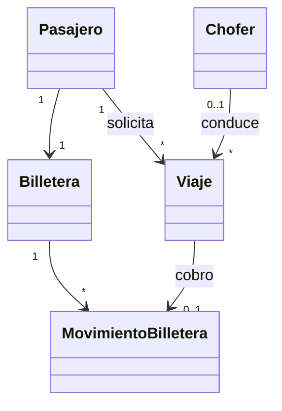

# Modelo de dominio

## Alcance confirmado

- Roles: pasajero, chofer, operador y administrador.
- Viaje con los estados exigidos por el enunciado.
- Billetera del pasajero formada por movimientos de carga y consumo.
- Dinero representado en centavos enteros.
- Un cobro de finalización puede quedar en `pago_pendiente` si el saldo no alcanza.

## Invariantes confirmadas

1. Un viaje se asigna a un solo chofer y un chofer tiene un solo viaje activo.
2. El saldo no se sobrescribe: se calcula desde movimientos confirmados.
3. Un mismo cobro o webhook no puede producir dos movimientos al reintentarse.
4. Dos cobros concurrentes no pueden consumir un saldo que alcanza para uno solo.
5. La tarifa se calcula en servidor y los importes se expresan en centavos enteros.
6. Un índice único parcial impide que un chofer tenga dos viajes activos.
7. Un índice único parcial impide dos consumos de billetera para el mismo viaje.

## Persistencia propuesta

- `viajes`, `ofertas_viaje` y `eventos_viaje` representan el ciclo del viaje y permiten reconstruir eventos SSE.
- `billeteras` identifica y bloquea la billetera del pasajero, sin guardar un saldo.
- `movimientos_billetera` es un libro inmutable: los débitos y créditos son importes positivos en centavos y el tipo determina el signo.
- `claves_idempotencia` recuerda el resultado de una intención HTTP por actor y ámbito.
- `eventos_webhook_pago` deduplica por el identificador del proveedor antes de crear una carga.
- PostGIS almacena `origen`, `destino` y ubicaciones como `geography(Point, 4326)` indexada con GiST.

## Cobro y `pago_pendiente`

El cobro se hace en una sola transacción al finalizar (`finalizarYCobrar`). Primero se bloquea el viaje y después la billetera del pasajero (`SELECT ... FOR UPDATE`). Ese orden se mantiene siempre para que no haya interbloqueos. Con la billetera bloqueada, dos cobros del mismo pasajero se hacen de a uno: el segundo ya ve el consumo del primero y no puede gastar un saldo que ya no existe.

| Desde | Hacia | Cuándo | Movimiento | Evento |
|---|---|---|---|---|
| `en_curso` | `finalizado` | El saldo alcanza para la tarifa | `consumo` por la tarifa | `cobro_confirmado` |
| `en_curso` | `finalizado` | La tarifa es 0 | Ninguno (el `CHECK` exige importe > 0) | `cobro_confirmado` con importe 0 |
| `en_curso` | `pago_pendiente` | El saldo no alcanza | Ninguno: el cobro nunca es parcial | `cobro_pendiente` |
| `pago_pendiente` | `finalizado` | El pasajero carga saldo y llama a `POST /viajes/:viajeId/reintentar-cobro` | `consumo` por `tarifa_final_centavos` | `cobro_confirmado` con `reintento: true` |

- Si el saldo todavía no alcanza, el reintento responde `409 SALDO_INSUFICIENTE` y el viaje sigue en `pago_pendiente`.
- Sólo el pasajero dueño del viaje puede reintentar. Si el viaje es de otro pasajero, la respuesta es `404`.
- Si llegan dos reintentos a la vez, el primero cobra. El segundo encuentra el viaje ya `finalizado` y responde `TRANSICION_INVALIDA`. Además, `ux_un_consumo_por_viaje` impide en la base un segundo consumo del mismo viaje.
- Un pasajero sin billetera no puede finalizar: la respuesta es `404 BILLETERA_NO_ENCONTRADA` y el viaje sigue `en_curso`. El registro crea la billetera en la misma transacción, así que en la práctica no pasa. Es una defensa para que el error no sea un 500.

## Decisiones pendientes

- TODO: definir si se permite una carga manual en demo y quién la inicia.
- TODO: definir reglas completas de tarifa, radio de búsqueda y orden de ofertas.
- TODO: definir retención/agregación de ubicaciones históricas.

## Diagrama inicial

