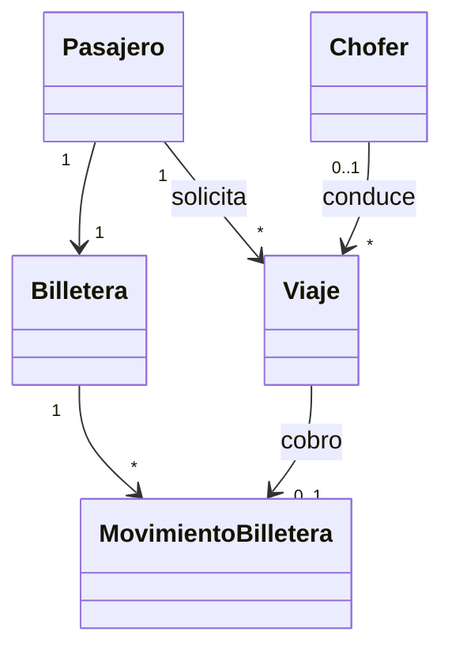

# Modelo de dominio

## Alcance confirmado

- Roles: pasajero, chofer, operador y administrador.
- Viaje con los estados exigidos por el enunciado.
- Billetera del pasajero formada por movimientos de carga y consumo.
- Dinero representado en centavos enteros.
- Un cobro de finalización puede quedar en `pago_pendiente` si el saldo no alcanza.

## Invariantes confirmadas

1. Un viaje se asigna a un solo chofer y un chofer tiene un solo viaje activo.
2. El saldo no se sobrescribe: se calcula desde movimientos confirmados.
3. Un mismo cobro o webhook no puede producir dos movimientos al reintentarse.
4. Dos cobros concurrentes no pueden consumir un saldo que alcanza para uno solo.
5. La tarifa se calcula en servidor y los importes se expresan en centavos enteros.
6. Un índice único parcial impide que un chofer tenga dos viajes activos.
7. Un índice único parcial impide dos consumos de billetera para el mismo viaje.

## Persistencia propuesta

- `viajes`, `ofertas_viaje` y `eventos_viaje` representan el ciclo del viaje y permiten reconstruir eventos SSE.
- `billeteras` identifica y bloquea la billetera del pasajero, sin guardar un saldo.
- `movimientos_billetera` es un libro inmutable: los débitos y créditos son importes positivos en centavos y el tipo determina el signo.
- `claves_idempotencia` recuerda el resultado de una intención HTTP por actor y ámbito.
- `eventos_webhook_pago` deduplica por el identificador del proveedor antes de crear una carga.
- PostGIS almacena `origen`, `destino` y ubicaciones como `geography(Point, 4326)` indexada con GiST.

## Decisiones pendientes

- TODO: definir transiciones válidas hacia y desde `pago_pendiente`.
- TODO: definir si se permite una carga manual en demo y quién la inicia.
- TODO: definir reglas completas de tarifa, radio de búsqueda y orden de ofertas.
- TODO: definir retención/agregación de ubicaciones históricas.

## Diagrama inicial

